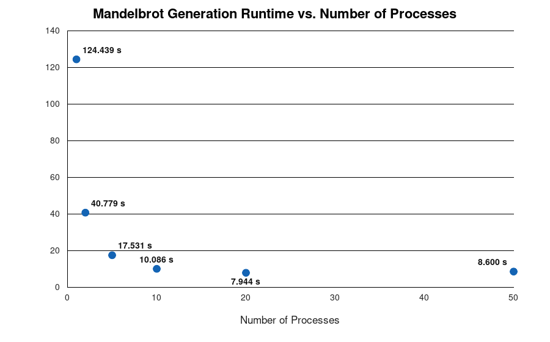

# CPE-2600 Lab 11: Multiprocessing

**Name:** Ava Latoria  
**Assignment:** Lab 11: Multiprocessing  
**Section:** CPE-2600 121

This project renders a 50-frame Mandelbrot zoom using multiple child
processes. `mandelmovie` maintains a configurable process pool. Each child is
created with `fork()` and then uses `execl()` to run `mandel` for one frame.
The parent starts another frame whenever a child finishes and waits for all
children before exiting.

## Build and run

The project requires the libjpeg development package. Build both programs
with:

```sh
make
```

Generate the required 50 frames with, for example, five simultaneous child
processes:

```sh
./mandelmovie -p 5
```

Frames are named `mandel0.jpg` through `mandel49.jpg`. The `-p` value must be
between 1 and the number of frames. Run `./mandelmovie -h` for optional testing
controls, including frame count, image size, iteration limit, and filename
prefix.

Create the movie after all frames are generated:

```sh
ffmpeg -i mandel%d.jpg mandel.mpg
```

## Runtime measurements

The program was timed while generating all 50 frames with each of the required
process counts.

| Processes | Runtime (seconds) |
|----------:|------------------:|
| 1         | 124.439           |
| 2         | 40.779            |
| 5         | 17.531            |
| 10        | 10.086            |
| 20        | 7.944             |
| 50        | 8.600             |



Increasing the number of child processes reduced the total generation time in
every test. The largest improvement occurred from one to two processes, where
runtime fell from 124.439 seconds to 40.779 seconds. Later increases still
helped, but produced diminishing returns: doubling from 10 to 20 processes
reduced runtime by only 2.142 seconds, compared with the much larger gains at
lower process counts. Increasing the pool to 50 processes raised the runtime
slightly to 8.600 seconds. This indicates that process-management overhead and
competition for the available CPU resources eventually outweigh the benefit
of adding more processes.
